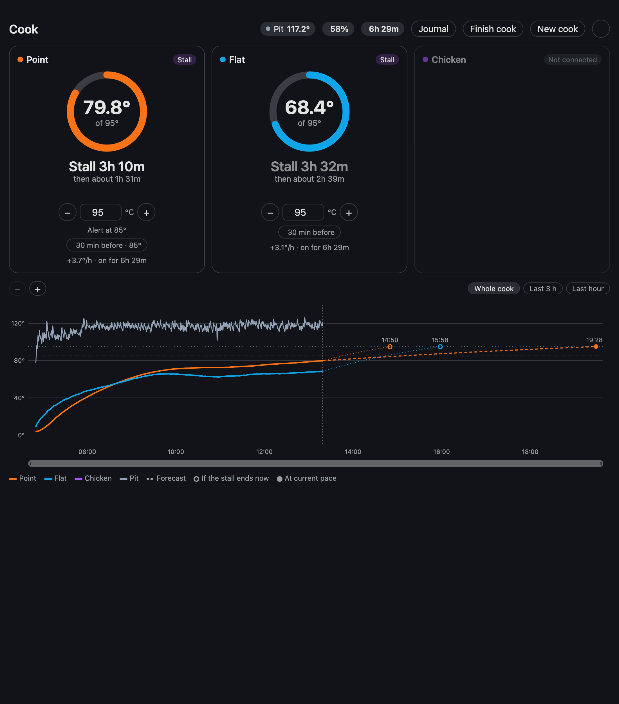
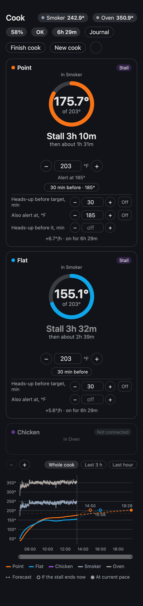

# Cook Predictor for Home Assistant

Tells you when your cook will be done, from whatever temperature probes you already have in
Home Assistant, and keeps a journal of every cook. It predicts like a dedicated smart
thermometer does: it fits how fast the food is heating toward the temperature around it,
spots a stall (the long plateau of a brisket or a pork shoulder) and says what to expect after
it, and alerts you before the food is ready.



## What you get

- **Any thermometer.** Pick the sensors yourself, from any integration: each one measures
  either the food (internal) or the cooker it is in (ambient: pit, oven, grill). One food
  probe is enough; add as many as you have. Mix devices freely, for example the probes of a
  Wi-Fi thermometer with the ambient sensor of another.
- **Several cookers at once.** Each food probe belongs to one cooker's ambient sensor (picked
  for you when there is only one), so a brisket in the smoker and a chicken in the oven are
  predicted each against its own heat.
- **A prediction per probe**: status (warming up, predicting, stall, done...), time left and
  the finish time, the rate, and in a stall the time it takes once the stall breaks.
- **Alerts** to your phone: a heads-up before the target, the target reached, a stall
  starting and ending, and an optional second temperature with its own heads-up. Each probe
  has its own settings.
- **A dashboard card** with a ring per probe, the targets and alert settings, the cookers'
  temperatures, each thermometer's battery, and a zoomable chart of the whole cook with the
  forecast to each finish.
- **A journal of every cook**: the full chart, stalls, when each probe reached its target,
  how close the forecasts were, and your notes. It is kept on disk, so cooks stay browsable
  after Home Assistant's recorder has purged them.
- **°C or °F**, whatever your Home Assistant uses. Sensors that report in °F or K are
  converted.



## Installing

Cook Predictor installs from the Marketplace (Home Assistant 2026.11 and later) or HACS (2026.10).

1. Open this repository in your Home Assistant:

   [](https://my.home-assistant.io/redirect/marketplace_repository/?owner=benyaming&repository=ha-cook-predictor&category=integration)
   Home Assistant 2026.11 and later

   [](https://my.home-assistant.io/redirect/hacs_repository/?owner=benyaming&repository=ha-cook-predictor&category=integration)
   Home Assistant 2026.10 with HACS

   Or add it by hand as a custom repository: **Settings › Marketplace** (or **HACS**) ›
   **⋮ › Custom repositories**, the URL of this page, type **Integration**.
2. Install **Cook Predictor** and restart Home Assistant.
3. Add the integration:

   [](https://my.home-assistant.io/redirect/config_flow_start/?domain=cook_predictor)

   or **Settings › Devices & services › Add integration › Cook Predictor**. Choose where alerts
   go (your phone's `mobile_app_…` service, or notify entities), then add your first sensor.

The card comes with the integration; nothing to add to your dashboard resources. Add it to a
dashboard with **Add card › Cook Predictor**, or in YAML:

```yaml
type: custom:cook-predictor-card
```

A panel view suits it best on a phone.

Every part of the card is optional. Open its **visual editor** (edit the dashboard ▸ the card ▸
the config dialog) to choose which probes and cookers show and to hide the journal, the finish /
new-cook buttons, the settings gear, the battery chips or the chart — or set the same options in
YAML:

```yaml
type: custom:cook-predictor-card
title: Brisket day        # optional title override
hidden_channels: ["3"]    # hide a probe or cooker by its number
show_journal: false       # hide the Journal button
show_actions: false       # hide Finish / New cook
show_settings: false      # hide the settings (gear) button
show_batteries: false     # hide the battery chips
show_chart: false         # hide the chart, zoom and legend
```

## Adding sensors

From Cook Predictor's page: **Add sensor**. Pick the sensor (temperature sensors only) and
what it measures:

- **Internal**: the food. Each internal sensor gets its own entities: a status sensor with the
  forecast in its attributes, a "Done at" timestamp, the target, the heads-up minutes, a second
  alert temperature with a switch, and its heads-up.
- **Ambient**: the pit, oven or grill. With more than one, pick each food probe's **Cooker**.

Further options:

- **Probe connected sensor**: a binary sensor that is off while the probe is unplugged (the
  Combustion Gauge has one; it is suggested when the device has exactly one temperature
  sensor). Without one, an unavailable sensor counts as a gap, not an unplug.
- **Thermometer type**: *Inkbird IBBQ* for Inkbird thermometers through
  [tuya_local](https://github.com/make-all/tuya-local), which read 3623 °C with no probe
  plugged in. Everything else is *Any other*.

A sensor and what it measures stay fixed: to use another one, remove the sensor and add the
other. You can add and remove sensors in the middle of a cook. A probe added joins the cook. A
probe removed and replaced within 30 minutes keeps the cook going, with a gap in its line.

## How the prediction works

Food heats like Newton's law of cooling: the gap between the food and its surroundings shrinks
at a rate set by the food (its size, its shape, how wet it is). Cook Predictor fits that rate
over the recent readings, simulating forward through the measured ambient temperature, and
projects the time to the target. Until the fit is good it says *Warming up*; a rough estimate
shows with a `~`.

A **stall** is the core rising far slower than its best fit so far would expect at the current
gap: evaporation at the surface is taking the heat. During a stall the card shows two
finishes: at the current pace, and if the stall ended now.

**Without an ambient sensor** the time left is a straight-line trend: rough, and too early for
food that slows as it nears the target. Heads-up alerts need the full model, so without an
ambient sensor you get the "target reached" alert but no heads-up.

## Limits worth knowing

- **Sensors that only report changes.** A probe whose sensor says nothing for 10 minutes
  shows *No reading*, because silence looks like a lost sensor. Most thermometer integrations
  report their value regularly even when it does not change (Home Assistant's
  `last_reported`), which keeps a flat stall fresh. One that only reports changes may show
  *No reading* during a long, flat stall.
- **Unplugging** is recognised from a probe connected sensor, or from the Inkbird's no-probe
  reading. For anything else, an unavailable sensor is a gap: the cook carries on.
- **Restarts.** After a Home Assistant restart, or a change to the sensors, the prediction is
  rebuilt from the recorder's last 30 hours. That takes from a few seconds to about half a
  minute on a small machine; meanwhile the probes show *Loading the cook so far*. Alerts
  already sent are not sent again, except one that was going out at the very moment Home
  Assistant stopped: that one may arrive twice rather than not at all.

## The journal

The **Journal** button on the card shows past cooks: when, how long, each probe from start to
peak, stalls, and each target with when it was reached. Open one for its chart, the forecasts
against the actual finish, and a name and notes you can edit. A cook starts with **New cook**,
or when a probe starts heating; it ends with **Finish cook**, when every probe has been unplugged
for 30 minutes, or 6 hours after the last reading when every probe is unplugged or unavailable
(the thermometer switched off).

The journal lives in `/config/cook_predictor/journal/` (included in Home Assistant backups). A
deleted cook moves to its `trash/` folder.

## Removing

Removing the integration leaves `/config/cook_predictor/` on disk with your journal. Delete
the folder yourself if you do not want it.

## License

MIT
